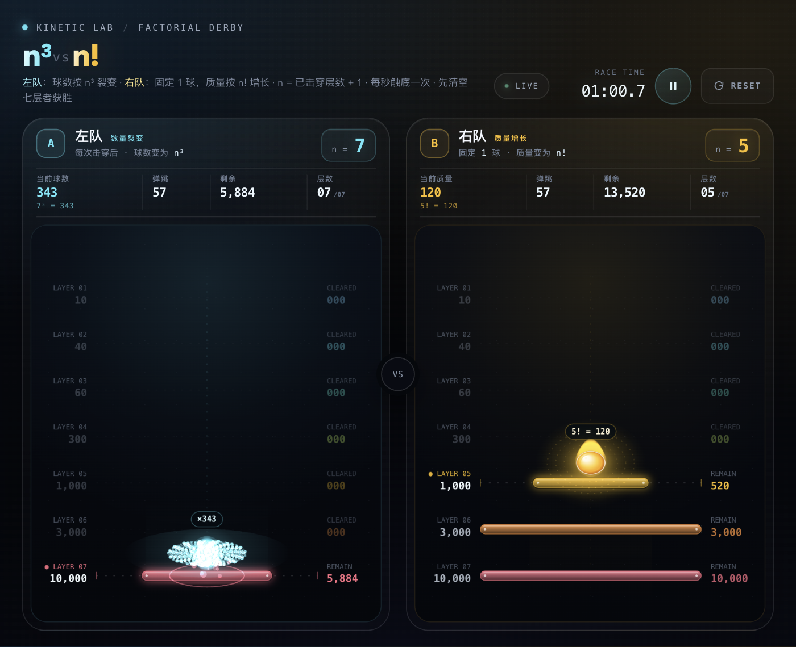
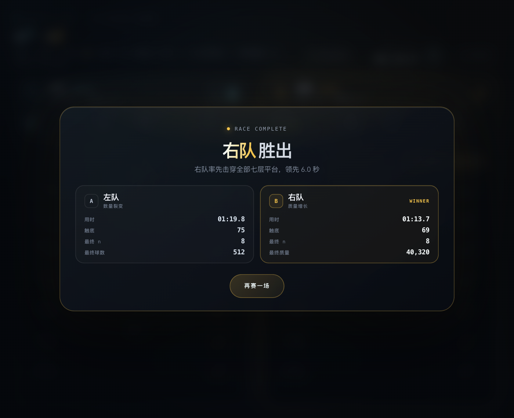

# n³ vs n!

一个纯前端 Canvas 双队竞速演示：**左队让球的数量按立方增长，右队让球的质量按阶乘增长**，在同一组七层平台上比赛，先清空全部平台的一队获胜。



## 比赛规则

七层平台从上到下的初始数值为：

`10 · 40 · 60 · 300 · 1,000 · 3,000 · 10,000`

两队共享同一套弹跳与坍塌规则：

- 每秒触底一次，不做加速。
- 每次触底，平台扣减当前队伍的球数或质量。
- 平台长度根据剩余数值等比例缩短，数值归零即坍塌。
- 平台坍塌后，球体落到下一层继续弹跳。
- `n = 已击穿平台数 + 1`。

两队的成长方式不同：

| 队伍 | 成长规则 | 每次触底的伤害 |
| --- | --- | --- |
| 左队 | 球的数量 = `n³` | 当前球数 |
| 右队 | 固定 1 球，质量 = `n!` | 当前质量 |

### 数值序列

| 已击穿平台数 | n | 左队球数 n³ | 右队质量 n! |
| ---: | ---: | ---: | ---: |
| 0 | 1 | 1 | 1 |
| 1 | 2 | 8 | 2 |
| 2 | 3 | 27 | 6 |
| 3 | 4 | 64 | 24 |
| 4 | 5 | 125 | 120 |
| 5 | 6 | 216 | 720 |
| 6 | 7 | 343 | 5,040 |
| 7 | 8 | 512 | 40,320 |

## 演示结果

按以上规则完整跑完一场，结果如下：

- **右队获胜**：69 次触底，最终质量 40,320，用时约 1:13.6。
- **左队**：75 次触底，最终球数 512，用时约 1:19.7。

实际用时可能因浏览器帧率产生极小差异，触底次数与胜负结果是确定的。



## 运行方式

项目没有构建步骤，也没有第三方依赖，直接打开 `index.html` 即可。

也可以启动一个本地静态服务器：

```bash
python3 -m http.server 8000
```

然后访问：

```text
http://localhost:8000
```

## 操作

- 点击右上角暂停按钮暂停或继续。
- 点击右上角 `Reset` 重新开始比赛。
- 键盘 `Space`：暂停 / 继续。
- 键盘 `R`：重置。

## 项目结构

```text
.
├── index.html          # 单文件演示：界面、动画与比赛逻辑
├── assets/
│   ├── race-action.png # 比赛现场截图
│   └── race-result.png # 比赛结果截图
└── README.md
```

## 实现说明

- 使用原生 HTML、CSS 和 Canvas 2D 绘制平台、球群、质量球、粒子与光效。
- 两支队伍拥有独立的模拟状态，共享同一个比赛时钟。
- 使用 `requestAnimationFrame` 驱动动画，以固定 1 秒的触底节奏推进模拟。
- 左队球群会随数量增加而横向铺开并逐渐扁平化；右队球体则随质量增长放大尺寸与光晕。
